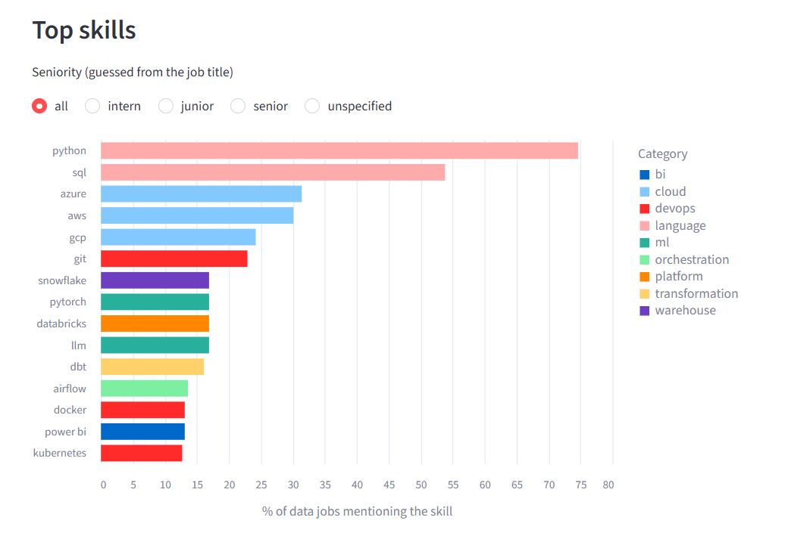
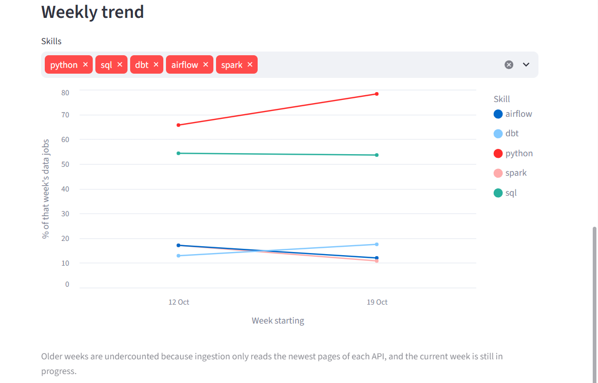
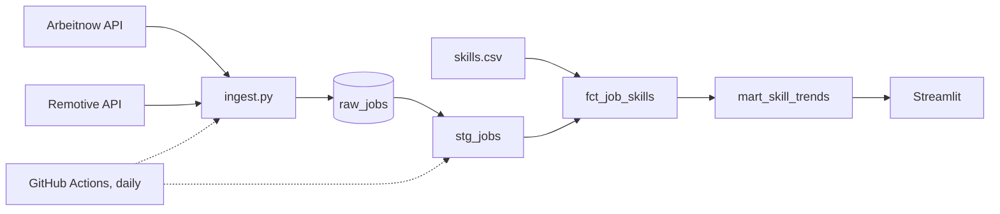

# Analyze Job Market
This project analyzes and tracks the job market from public job APIs and cleans
the raw data into a Streamlit dashboard, so users can see which skills are in demand.




## What it answers

- Which skills show up most in data job postings?
- Does that change for intern / junior / senior roles?
- How do skills trend week to week?

As of late October 2026 it has ~4,300 postings, 236 of them data roles.
Python appears in about 3 out of 4 data postings and SQL in a bit over half.

## How it works



1. **Ingest** (`ingestion/ingest.py`): pulls both APIs, stores each posting as
   raw JSON with an md5 of the payload. A row is only inserted if that
   (source, job_id, hash) is new, so reruns don't duplicate anything and
   edited postings are kept as new versions.
2. **Staging** (`dbt/models/staging`): one model per source maps the JSON to
   common columns, then `stg_jobs` unions them, keeps the latest version of
   each job, strips HTML and flags data roles and seniority.
3. **Marts** (`dbt/models/marts`): `fct_job_skills` matches the job text
   against regex patterns in `seeds/skills.csv`. `mart_skill_trends` counts
   jobs per skill per week, as a count and as a % of that week's data jobs.
4. **Tests**: 19 dbt tests (nulls, accepted values, uniqueness, a volume
   check and a freshness check). The workflow runs `dbt build`, so if staging
   fails, the marts aren't rebuilt and the dashboard keeps the last good data.

## Stack

| Tool | Why |
|---|---|
| Python + requests | Simple API pulls, no framework needed |
| DuckDB / MotherDuck | Data is small, so no need for Spark. Same SQL locally and in the cloud |
| dbt | Transformations as versioned SQL, with tests and lineage |
| GitHub Actions | Free scheduler, nothing running on my machine |
| Streamlit | Quick dashboard in Python |

## Design decisions

- **Raw JSON is kept as-is.** I can add columns later without re-pulling.
- **The database is not in the repo.** GitHub Actions runners are thrown away
  after each run, and committing scraped postings to a public repo isn't
  something I wanted to do, so data lives in MotherDuck (free tier).
- **Filter in dbt, not at ingest.** Everything is stored raw and data roles
  are flagged in staging, so the filter can change without re-pulling.
- **Skills live in a CSV seed.** Adding a skill is one line, no SQL change.

## Problems I ran into

- **Remotive only returned ~10 jobs**, and after filtering none of them were
  actual data roles. I added Arbeitnow as a second source.
- **Duplicates while paginating.** New postings shift items between pages,
  so the same job showed up on two pages (~150 rows on the first load).
  Fixed by deduping within each batch.
- **Fake "edits".** ~80 jobs looked edited within a single run. Arbeitnow
  appends a random promo line to each description, which changed the hash.
  The raw payload is still stored as-is, but the footer is stripped before hashing.
- **The data role filter was too loose.** Matching any "data" or "analyst"
  pulled in lawyers, sales and security roles. It now needs a specific role
  phrase and excludes a few words. I checked it by reading random samples of
  both flagged and unflagged titles.
- **A green run that didn't load anything.** The first GitHub Actions run
  passed but wrote to a throwaway local file, because the change that points
  ingest at MotherDuck hadn't been pushed. The script now logs which database
  it writes to.

## Limitations

- Most postings are in Europe or remote. This is not a picture of any one
  country's market.
- Data roles and seniority are guessed from the title, so some are missed.
- Ingestion reads only the newest 10 pages of Arbeitnow, so older weeks are
  undercounted. Trends need a few more weeks of daily runs to mean much.
- Arbeitnow bumps `created_at` when a posting is edited, so `published_at`
  reflects the latest edit.

## Run it locally

```bash
python -m venv .venv
.venv\Scripts\activate          # macOS/Linux: source .venv/bin/activate
pip install -r requirements.txt

python ingestion/ingest.py      # writes to data/jobs.duckdb
cd dbt
dbt build                       # target "dev" = the local file
```

The dashboard reads from MotherDuck and needs a `MOTHERDUCK_TOKEN`:

```bash
pip install -r dashboard/requirements.txt
streamlit run dashboard/app.py
```

## Project structure

```
ingestion/        API pulls into raw_jobs
dbt/
  models/staging  per-source models + stg_jobs
  models/marts    fct_job_skills, mart_skill_trends
  seeds/          skills.csv
  tests/          custom SQL tests
dashboard/        Streamlit app
scripts/          one-off checks I used while building
.github/workflows daily pipeline
docs/             schema notes and screenshots
```

## What I'd do next

- Add a Thai job board as a third source
- Alert on Slack or email when a test fails, not just a red run

